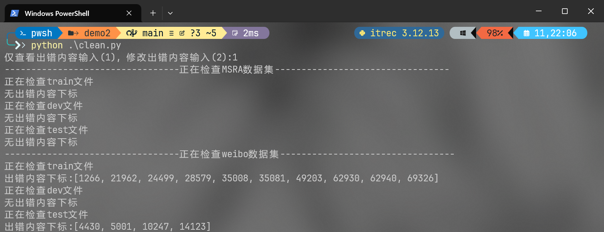
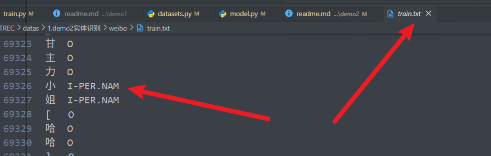
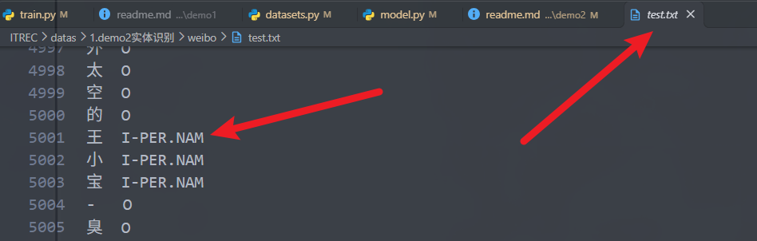
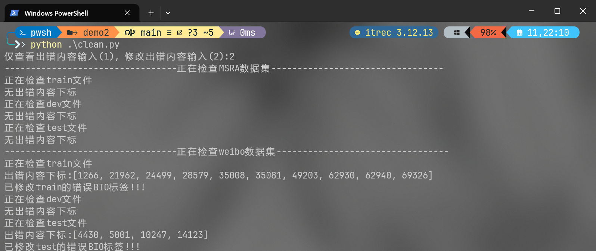

# ITREC 新生训练营demo2
该项目基于MSRA和weibo数据集，bert-base-chinese和hfl/chinese-bert-wwm模型, 在原有模型的基础上添加分类头，以完成ner识别的任务。<br>
具体数据集和demo说明参考仓库：**https://github.com/DMU-ITREC/itrec-nlp-newcomer-guide/tree/main**
## 项目文件
- \ datas \ 0.demo1文本分类 \ new_id_convert.json : 新闻id和对应新闻的对应关系，以及新闻id和id的对应关系
- \ config \ base.json : 模型基础配置文件
- datasets_clean.py : 数据预处理文件(清洗以及生成new_id_convert.json)
- datasets.py : 数据集文件
- environment.yml : conda环境文件
- evaluationMetrics.py : 模型指标文件
- model.py : 模型文件
- train.py : 模型训练文件
- utils.py : 通用工具文件

## 快速运行
```项目目录
├── ITREC
    ├── datas
    ├   └── 0.demo1文本分类
    ├       └── new_id_convert.json
    └── Demo
        └── demo2
            └── config
            ├   ├   option.json
            ├   └── base.json
            ├   datasets_clean.py
            ├   datasets.py
            ├   environment.yml
            ├   evaluationMetrics.py
            ├   model.py
            ├   train.py
            └── utils.py
```
运行命令目录(命令均在Demo2路径下):
```
cd ~\ITREC\Demo\Demo2
```

## 数据集处理
在终端输入
```powershell
python clean.py
``` 
输入1，
结果如下：<br>

可以看到在weibo的数据集的train.txt和test.txt文件中的实体BIO标签出现错误，且排查后发现错误都是`实体以I-xxx起始，而不是B-xxx`，如下图所示：


接下来继续终端输入
```powershell
python clean.py
``` 
输入2，
结果如下：<br>

