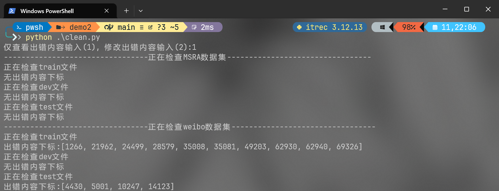
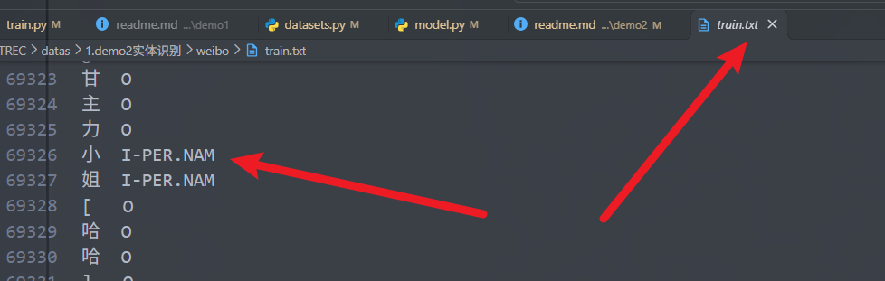
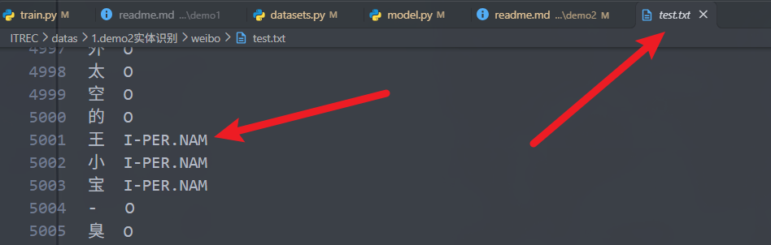
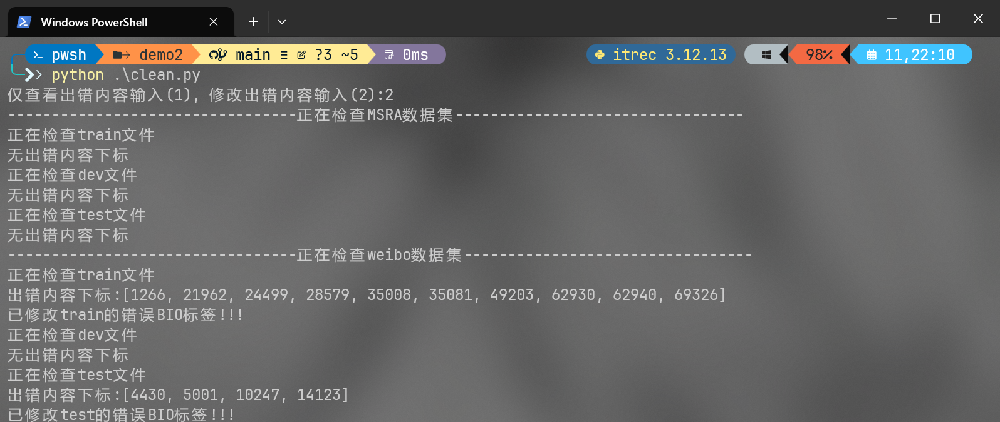

# ITREC 新生训练营demo2
该项目基于MSRA和weibo数据集，bert-base-chinese和hfl/chinese-bert-wwm模型, 在原有模型的基础上添加分类头，以完成ner识别的任务。<br>
具体数据集和demo说明参考仓库：**https://github.com/DMU-ITREC/itrec-nlp-newcomer-guide/tree/main**
## 项目文件
- \ datas \ .demo2实体识别 \ MSRA \ labels2id.json : 标签和id的转换
- \ datas \ 1.demo2实体识别 \ weibo \ labels2id.json : 标签和id的转换
- \ config \ base.json : 模型基础配置文件
- \ config \ options.json : 模型数据集和模型配置文件
- clean.py : 数据预处理文件（查看是否有违规BIO标签）
- datasets.py : 数据集文件
- environment.yml : conda环境文件
- evaluationMetrics.py : 模型指标文件（实体级 Micro P/R/F1）
- init.py : 初始化，下载模型相关文件、统计数据集BIO标签类别以及数量
- model.py : 模型文件
- train.py : 模型训练文件
- utils.py : 通用工具文件

## 环境
项目环境参考文件：environment.yml
主要运行环境：pytorch、transformers、swanlab

## 快速运行
```
├── ITREC
    ├── datas
    ├   └── 1.demo2实体识别
    ├       ├   MSRA
    ├       └── weibo
    ├── Demo
    ├    └── demo2
    ├       ├── config
    ├       ├   ├   ......
    ├       ├   ├── options.json
    ├       ├   └── base.json
    ├       ├── clean.py
    ├       ├── datasets.py
    ├       ├── environment.yml
    ├       ├── evaluationMetrics.py
    ├       ├── init.py
    ├       ├── model.py
    ├       ├── train.py
    ├       └── utils.py
    ├── outputs
    ├    └── demo2
    ├── pretrained_models
```
运行命令目录(命令均在Demo2路径下):
```
cd ~\ITREC\Demo\demo2
```
### 1.项目初始化
初始化之前，需要保持以上的项目目录。<br>
在终端输入
```powershell
python init.py
``` 
`*如果超时或者下载较慢，可以提前输入`<br>

bash : **export HF_ENDPOINT=https://hf-mirror.com**<br>
powershell : **$env:HF_ENDPOINT="https://hf-mirror.com"**

1.下载模型权重与 tokenizer 并保存到 ../../pretrained_models<br>
2.获取并打印两个数据集的BIO情况<br>
3.保存两个数据集的class.txt、labels2id.json和labels.json 并 更新options.json文件
### 2.数据集处理
在终端输入
```powershell
python clean.py
``` 
输入1，
结果如下：<br>

可以看到在weibo的数据集的train.txt和test.txt文件中的实体BIO标签出现错误，且排查后发现错误都是`实体以I-xxx起始，而不是B-xxx`，如下图所示：


接下来继续终端输入
```
python clean.py
``` 
输入2，
结果如下：<br>

### `clean 之后重跑 python init.py 刷新`

### 3.swanlab登录
```powershell
swanlab login
``` 
登录 swanlab,并修改配置文件中的swanlab_project和swanlab_workspace
```json
"train":{
        "epochs" : 5,
        "ES_patience" : 3,
        "warmup_ration" : 0.1,
        "adamW_bert_lr" : 2e-5,
        "adamW_classifier_lr" : 1e-3,
        "adamW_weight_decay": 0.01,
        "adamW_eps" : 1e-8,
        "seed" : 5,
        "swanlab_project" : "ner-demo2",
        "swanlab_workspace" : "iwills"
    },
```
### 4.运行train.py文件
在终端运行该文件的时候, 根据需要声明自己创建的config文件（configs目录，默认路径在utils.py中声明）<br>
`*数据集和模型名称必须声明`<br>
可以先-h查看可选数据集和模型
```powershell
python .\train.py -h
usage: train.py [-h] [--config CONFIG] --dataset {MSRA,weibo} --model
                {bert-base-chinese,hfl/chinese-bert-wwm}

options:
  -h, --help            show this help message and exit
  --config CONFIG
  --dataset {MSRA,weibo}
                        数据集名称
  --model {bert-base-chinese,hfl/chinese-bert-wwm}
                        模型名称
```
然后开始训练
```powershell
#使用默认base.json
python train.py --dataset MSRA --model bert-base-chinese
#使用自定义
python train.py --config .\config\epoch10_ES5.json --dataset MSRA --model bert-base-chinese
```
## labels2id
### MSRA
labels2id.json
```json
{
    "I-LOC": 0,
    "I-PER": 1,
    "I-ORG": 2,
    "O": 3,
    "B-PER": 4,
    "B-ORG": 5,
    "B-LOC": 6
}
```
labels.json
```json
{
    "train": {
        "B-LOC": 3952,
        "I-LOC": 5313,
        "O": 206412,
        "B-PER": 1850,
        "I-PER": 3612,
        "B-ORG": 2158,
        "I-ORG": 9141
    },
    "dev": {
        "O": 35046,
        "B-LOC": 646,
        "I-LOC": 975,
        "B-PER": 308,
        "I-PER": 559,
        "B-ORG": 325,
        "I-ORG": 1348
    },
    "test": {
        "O": 34967,
        "B-LOC": 648,
        "I-LOC": 1027,
        "B-PER": 510,
        "I-PER": 1082,
        "B-ORG": 287,
        "I-ORG": 1309
    }
}
```
### weibo
labels2id.json
```json
{
    "I-GPE.NAM": 0,
    "B-LOC.NOM": 1,
    "I-GPE.NOM": 2,
    "I-PER.NOM": 3,
    "B-LOC.NAM": 4,
    "I-PER.NAM": 5,
    "I-LOC.NOM": 6,
    "I-ORG.NAM": 7,
    "O": 8,
    "B-GPE.NAM": 9,
    "B-ORG.NOM": 10,
    "B-GPE.NOM": 11,
    "B-PER.NOM": 12,
    "I-LOC.NAM": 13,
    "B-PER.NAM": 14,
    "I-ORG.NOM": 15,
    "B-ORG.NAM": 16
}
```
labels.json
```json
{
    "train": {
        "O": 68777,
        "B-PER.NOM": 772,
        "I-PER.NOM": 1037,
        "B-LOC.NAM": 56,
        "I-LOC.NAM": 129,
        "B-PER.NAM": 578,
        "I-PER.NAM": 1037,
        "B-GPE.NAM": 205,
        "I-GPE.NAM": 241,
        "B-ORG.NAM": 183,
        "I-ORG.NAM": 477,
        "B-ORG.NOM": 42,
        "I-ORG.NOM": 61,
        "B-LOC.NOM": 51,
        "I-LOC.NOM": 66,
        "B-GPE.NOM": 8,
        "I-GPE.NOM": 8
    },
    "dev": {
        "O": 13492,
        "B-PER.NOM": 208,
        "I-PER.NOM": 239,
        "B-GPE.NAM": 26,
        "I-GPE.NAM": 31,
        "B-ORG.NOM": 5,
        "I-ORG.NOM": 5,
        "B-LOC.NOM": 6,
        "I-LOC.NOM": 7,
        "B-PER.NAM": 90,
        "I-PER.NAM": 157,
        "B-ORG.NAM": 47,
        "I-ORG.NAM": 126,
        "B-LOC.NAM": 6,
        "I-LOC.NAM": 16,
        "B-GPE.NOM": 1,
        "I-GPE.NOM": 1
    },
    "test": {
        "O": 13732,
        "B-PER.NAM": 113,
        "I-PER.NAM": 200,
        "B-GPE.NAM": 47,
        "I-GPE.NAM": 62,
        "B-ORG.NOM": 17,
        "I-ORG.NOM": 22,
        "B-PER.NOM": 172,
        "I-PER.NOM": 214,
        "B-LOC.NAM": 19,
        "I-LOC.NAM": 45,
        "B-LOC.NOM": 9,
        "I-LOC.NOM": 15,
        "B-GPE.NOM": 2,
        "I-GPE.NOM": 2,
        "B-ORG.NAM": 39,
        "I-ORG.NAM": 100
    }
}
```
## 不同超参数下的指标对比
在swanlab上的训练数据展示url:https://swanlab.cn/@iwills/ner-demo2/v1/ps4l3k/overview
### MSRA
| 序号 | 训练 | epochs | EarlyStopping | warmup—ratio | batch | dropout | bert-base-lr | classifier-lr |  dev_entity_f1 | Test Token Loss | test_entity_f1 |
| :---: | :---: | :---: | :---: | :---: | :---: | :---: | :---: | :---: | :---: | :---: | :---: |
| 1 | bbc-normal | 5 | 3 | 0.1 | 32 | 0.1 | $2 * 10^{-5}$ | $1 * 10^{-3}$ | 0.9077 | 0.0516 | **0.8877** |
| 2 | bbc-batch64-lr | 5 | 3 | 0.1 | 64 | 0.1 | $4 * 10^{-5}$ | $2 * 10^{-3}$ | 0.9099 | 0.0488 | **0.8940** |
| 3 | bbc-bblr5_6 | 5 | 3 | 0.1 | 32 | 0.1 | $5 * 10^{-6}$ | $1 * 10^{-3}$ | 0.8695 | 0.0496 | **0.8562** |
| 4 | bbc-dropout0.3 | 5 | 3 | 0.1 | 32 | 0.3 | $2 * 10^{-5}$ | $1 * 10^{-3}$ | 0.9160 | 0.0511 | **0.8931** |
| 5 | bbc-epoch10_ES5 | 10 | 5 | 0.1 | 32 | 0.1 | $2 * 10^{-5}$ | $1 * 10^{-3}$ | 0.9197 | 0.0629 | **0.9074** |
| 6 | hbw-normal | 5 | 3 | 0.1 | 32 | 0.1 | $2 * 10^{-5}$ | $1 * 10^{-3}$ | 0.9115 | 0.0484 | **0.8995** |
| 7 | hbw-batch64-lr | 5 | 3 | 0.1 | 64 | 0.1 | $4 * 10^{-5}$ | $2 * 10^{-3}$ | 0.9222 | 0.0470 | **0.9034** |
| 8 | hbw-bblr5_6 | 5 | 3 | 0.1 | 32 | 0.1 | $5 * 10^{-6}$ | $1 * 10^{-3}$ | 0.8734 | 0.0512 | **0.8601** |
| 9 | hbw-dropout0.3 | 5 | 3 | 0.1 | 32 | 0.3 | $2 * 10^{-5}$ | $1 * 10^{-3}$ | 0.9190 | 0.0472 | **0.9086** |
| 10 | hbw-epoch10_ES5 | 10 | 5 | 0.1 | 32 | 0.1 | $2 * 10^{-5}$ | $1 * 10^{-3}$ | 0.9294 | 0.0569 | **0.9069** |

- bbc-normal(1)和bbc-batch64-lr(2)以及hbw-normal(6)和hbw-batch64-lr(7),都是同等比例的增加batch-size和增大lr，训练得到的entity-f1的结果大致相同，但batch64-lr得到的结果略高一些
- bbc-bblr5_6(3)和hbw-bblr5_6(8)因为bert-base的lr略小，模型在梯度下降的时候，对于参数的调整较小，使得模型的拟合速度略小于其他参数下的模型
- bbc-dropout0.3(4)和hbwdropout0.3(9)的dropout均大于normal，模型在dropout为0.3时的收敛效果大于0.1，模型的效果略优
- bbc-epoch10_ES5(5)和hbw-epoch10_ES5(10)的epochs更大，且适当的调高了early stopping，可以观察到拟合效果更优，entity-f1的值略微提高。且查看bbc和hbw的normal的训练图像，可以看到两个模型的训练结果都在提高，所以当epochs为5的时候，模型还未完全收敛

### weibo
| 序号 | 训练 | epochs | EarlyStopping | warmup—ratio | batch | dropout | bert-base-lr | classifier-lr |  dev_entity_f1 | Test Token Loss | test_entity_f1 |
| :---: | :---: | :---: | :---: | :---: | :---: | :---: | :---: | :---: | :---: | :---: | :---: |
| 1 | bbc-normal | 5 | 3 | 0.1 | 32 | 0.1 | $2 * 10^{-5}$ | $1 * 10^{-3}$ | 0.6710 | 0.1265 | **0.6075** |
| 2 | bbc-batch64-lr | 5 | 3 | 0.1 | 64 | 0.1 | $4 * 10^{-5}$ | $2 * 10^{-3}$ | 0.6641 | 0.1266 | **0.6075** |
| 3 | bbc-bblr5_6 | 5 | 3 | 0.1 | 32 | 0.1 | $5 * 10^{-6}$ | $1 * 10^{-3}$ | 0.5846 | 0.1602 | **0.4562** |
| 4 | bbc-dropout0.3 | 5 | 3 | 0.1 | 32 | 0.3 | $2 * 10^{-5}$ | $1 * 10^{-3}$ | 0.6871 | 0.1223 | **0.6557** |
| 5 | bbc-epoch10_ES5 | 10 | 5 | 0.1 | 32 | 0.1 | $2 * 10^{-5}$ | $1 * 10^{-3}$ | 0.7155 | 0.1247 | **0.6794** |
| 6 | hbw-normal | 5 | 3 | 0.1 | 32 | 0.1 | $2 * 10^{-5}$ | $1 * 10^{-3}$ | 0.6896 | 0.1347 | **0.6050** |
| 7 | hbw-batch64-lr | 5 | 3 | 0.1 | 64 | 0.1 | $4 * 10^{-5}$ | $2 * 10^{-3}$ | 0.6835 | 0.1155 | **0.6428** |
| 8 | hbw-bblr5_6 | 5 | 3 | 0.1 | 32 | 0.1 | $5 * 10^{-6}$ | $1 * 10^{-3}$ | 0.5921 | 0.1643 | **0.4735** |
| 9 | hbw-dropout0.3 | 5 | 3 | 0.1 | 32 | 0.3 | $2 * 10^{-5}$ | $1 * 10^{-3}$ | 0.6868 | 0.1162 | **0.6505** |
| 10 | hbw-epoch10_ES5 | 10 | 5 | 0.1 | 32 | 0.1 | $2 * 10^{-5}$ | $1 * 10^{-3}$ | 0.7107 | 0.1209 | **0.6659** |
- `相比于MSRA，weibo数据集的train、dev和test的语料均小于MSRA的语料，所以模型的拟合效果略差`

- bbc-normal(1)和bbc-batch64-lr(2)以及hbw-normal(6)和hbw-batch64-lr(7),与MSRA得出的结果相似，都是同等比例的增加batch-size和增大lr，训练得到的entity-f1的结果大致相同。但bbc的batch64-lr得到的结果相似，hbw的batch64-lr结果略优
- bbc-bblr5_6(3)和hbw-bblr5_6(8)，与MSRA得到的结果相似，因为bert-base的lr略小，模型在梯度下降的时候，对于参数的调整较小，使得模型的拟合速度略小于其他参数下的模型
- bbc-dropout0.3(4)和hbwdropout0.3(9)的dropout均大于normal，模型在dropout为0.3时的收敛效果大于0.1，模型的效果略优
- bbc-epoch10_ES5(5)和hbw-epoch10_ES5(10)的epochs更大，且适当的调高了early stopping，可以观察到拟合效果更优，entity-f1的值略微提高。且查看bbc和hbw的normal的训练图像，可以看到两个模型的训练结果都在提高，所以当epochs为5的时候，模型还未完全收敛